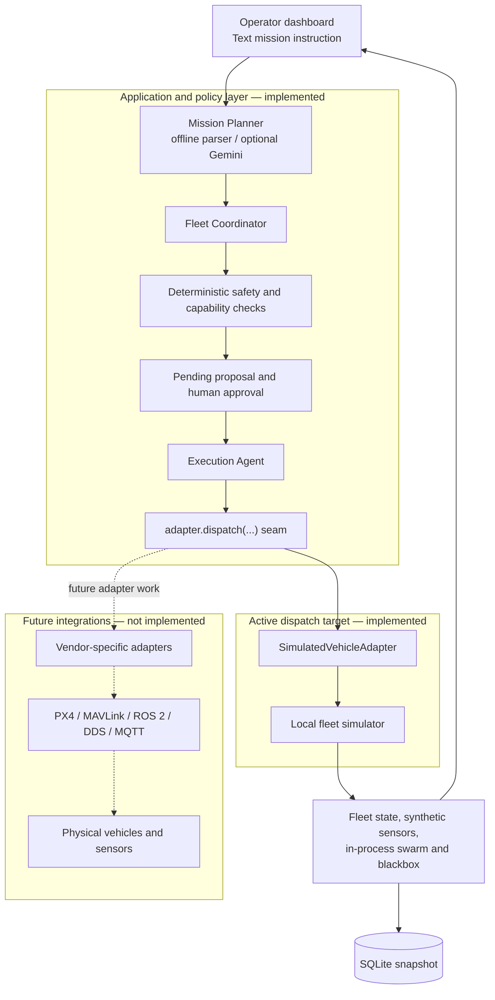
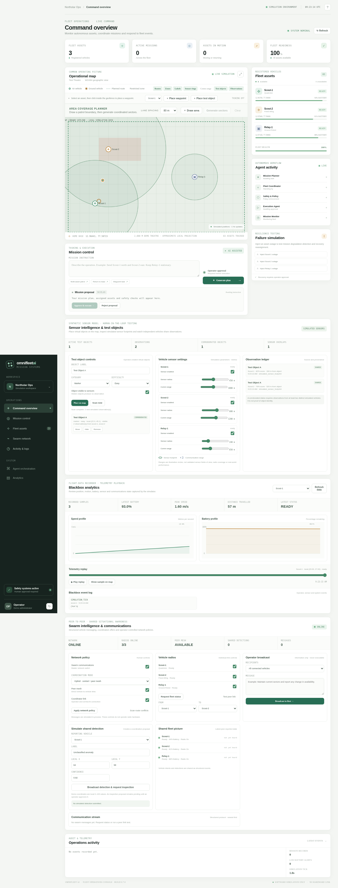
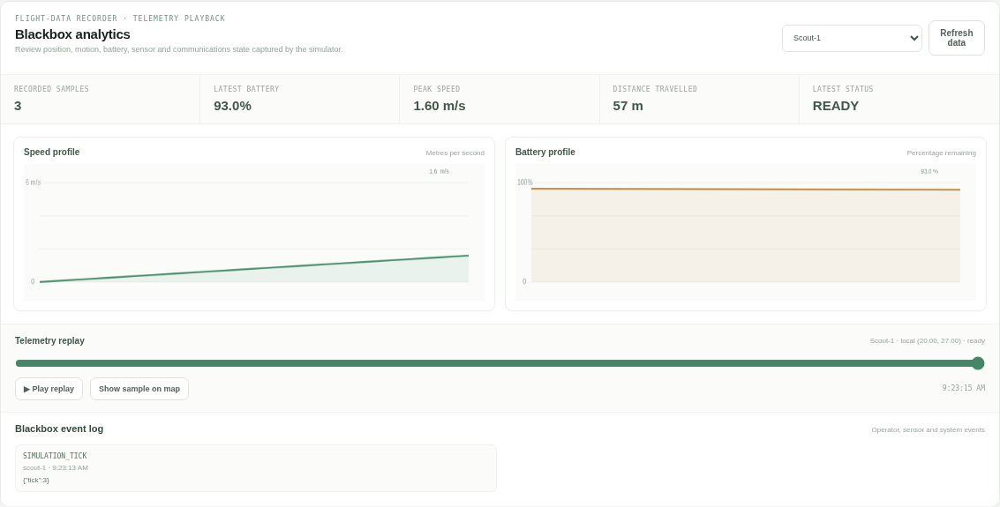

# OmniFleet AI

**A software-only demonstration of collaborative, human-supervised autonomous fleet orchestration.**

The v0.9.2 objective is reliable, human-supervised autonomy within a bounded simulation: SI-consistent motion, safe routing around static and moving virtual obstacles, synchronized multi-vehicle separation, energy-aware recovery proposals, delayed-observation aggregation, retryable peer coordination, recipient-specific fleet knowledge, and configurable latency and packet-loss scenarios.

OmniFleet turns operator intent into proposed fleet actions, validates them with deterministic policy checks, waits for explicit human approval, simulates execution, shares structured observations between vehicles, and records a blackbox history for review.

## The interoperability problem this project explores

Autonomous fleets can be fragmented across different vehicle types, manufacturers, command interfaces and telemetry formats. An operator may need one coherent way to describe a mission, while the software underneath must determine which assets are available and capable, coordinate their assignments, enforce policy, and present their state in one operational view.

OmniFleet explores the **software orchestration layer** of that problem. It uses a shared internal model for three heterogeneous simulated asset profiles, translates text instructions into structured mission proposals, performs capability-aware coordination and deterministic validation, requires operator approval, and presents simulated fleet state, observations and messages through one dashboard.

That is a relevant architectural pattern for interoperable autonomous systems, but it is not yet real hardware interoperability. This release has no manufacturer-specific command adapters or physical telemetry integrations. Its only active dispatch target is the local simulator. See [Interoperability Scope and Integration Roadmap](docs/INTEROPERABILITY_SCOPE.md) for a precise status breakdown.

## Architecture at a glance

The diagram distinguishes the working v0.9.2 execution path from possible future integrations. The dashed connectors and future targets are **not implemented or connected**.



The current adapter seam is a method-level dispatch boundary, not a production plugin framework. `PX4SITLAdapter` is a placeholder that deliberately refuses dispatch; it is not selected by the running app. The detailed component view is in [System Architecture](docs/01_SYSTEM_ARCHITECTURE.md).

## What is implemented, simulated, and future work

| Scope | v0.9.2 status | Honest interpretation |
|---|---|---|
| Text mission planning, fleet coordination, deterministic policy checks and human approval | **Implemented** | Working software workflow; optional Gemini is used only for planning roles |
| Heterogeneous vehicle profiles and capability-aware assignment | **Simulated** | Different asset profiles are represented in one internal model; no real vendor platforms are connected |
| Vehicle motion, failure recovery, area coverage and separation checks | **Simulated** | Executed in a local 2-D simulator; not validated flight-control behaviour |
| Shared operational view, sensor observations and swarm messaging | **Simulated** | Uses synthetic telemetry/observations and an in-process message bus |
| SQLite persistence and dashboard/API | **Implemented locally** | Single-process local application, not a production multi-user service |
| Manufacturer-specific adapters, physical telemetry, cameras/computer vision, radios, voice input and external C2 federation | **Future work** | Not implemented or connected in this release |

For the full implementation boundary and a staged integration roadmap, read [Interoperability Scope](docs/INTEROPERABILITY_SCOPE.md) and [Safety & Limitations](docs/SAFETY_AND_LIMITATIONS.md).

> **Simulation only.** This project does not connect to physical drones, cameras, radios, autopilots, PX4, MAVLink, ROS 2 or MQTT. It is not a flight-control system and must not be used for navigation or safety-critical decisions.

For a complete explanation of **everything the current system does**, including fleet and agent responsibilities, mission and sensor workflows, swarm messaging, safety guards, battery and failure recovery, configuration, task-by-task behaviour scenarios, API mapping, limitations and test traceability, start with the [System Capabilities & Behaviour Specification](docs/SYSTEM_CAPABILITIES_AND_BEHAVIOUR.md). It is the main whole-system reference for this release.

## At a glance

- FastAPI backend and lightweight HTML/CSS/JavaScript dashboard.
- Three heterogeneous simulated assets: two aerial profiles and one ground robot.
- Natural-language mission proposals with offline planning and optional Gemini Developer API support.
- Deterministic safety validation and human approval before every dispatch.
- Geographic display over a configurable illustrative local theatre, with a schematic fallback.
- Multi-vehicle area coverage planning and simulated failure/recovery proposals.
- Centralized/hybrid structured swarm-message simulation.
- Interactive virtual sensor objects, observation sharing and provenance.
- SQLite state persistence and per-vehicle blackbox telemetry/replay.

## Dashboard



The screenshot uses the **offline schematic map fallback**. With internet access and successful Leaflet/OpenStreetMap tile loading, the main map displays the geographic basemap instead. The fallback remains interactive for waypoint tasking, coverage drawing and virtual-object placement.

| Sensor intelligence | Blackbox analytics |
|---|---|
|  |  |

## Start locally

**Requirements:** Python 3.10+ (tested here with Python 3.13), pip, and a modern browser. Internet is only needed for the public Leaflet/OpenStreetMap basemap and optional Gemini API calls.

### Linux / macOS

Extract the downloaded ZIP, open a terminal in the extracted `omnifleet-ai` folder, then run:

```bash
python -m venv .venv
source .venv/bin/activate
pip install -r requirements.txt
cp .env.example .env
uvicorn backend.main:app --reload
```

### Windows PowerShell

Extract the downloaded ZIP, open PowerShell in the extracted `omnifleet-ai` folder, then run:

```powershell
python -m venv .venv
.venv\Scripts\Activate.ps1
pip install -r requirements.txt
Copy-Item .env.example .env
uvicorn backend.main:app --reload
```

Open **http://127.0.0.1:8000**. The first run seeds Scout-1, Scout-2 and Relay-1 automatically. State is saved to `data/omnifleet.sqlite3` by default.

For more setup detail, environment options and reset instructions, see [Getting Started](docs/GETTING_STARTED.md).

## First five-minute walkthrough

1. In **Mission Control**, use a prompt example or enter `Send Scout-1 north and Scout-2 east. Keep Relay-1 stationary.`
2. Select **Generate plan**. Read the proposed actions, agent trace and checks.
3. Select **Approve & execute**. Watch vehicle state update on the map and in Fleet Assets.
4. In **Sensor Intelligence**, place a visible Easy test object near local coordinate `(22, 45)` and select **Scan now**. The default geometry can produce observations from Scout-1 and Scout-2.
5. Open **Blackbox Analytics** to inspect per-vehicle speed, battery, event history and replay.
6. In **Swarm Intelligence & Communications**, test a peer link. Hybrid peer delivery checks both vehicles’ configured communication radii against their current separation. The network controls also simulate bounded delivery latency and deterministic packet loss.
7. To see the sensor-to-task loop, set Scout-1 and Scout-2 sensor ranges to 700 m, place an Easy object where both sensors can observe it, and select **Scan now**. Corroboration can arrive across separate scans. A qualifying detection automatically creates a peer-coordinated inspection proposal. Mission Control selects it for review; no vehicle moves until you restore the coordinator link (if disconnected) and explicitly approve.
8. Try a waypoint whose straight line crosses the restricted zone or the fixed simulated structure. The planner inserts detour waypoints; destinations inside restricted/obstacle geometry are rejected.
9. Lower a vehicle battery below 20% (or let a long simulation run drain it). The planner checks whether the return route has enough estimated energy plus reserve; if not, it proposes a local emergency land (air vehicle) or hold (ground vehicle), where the current simulated location is safe. Unsafe local positions produce `RECOVERY_UNAVAILABLE`. Every recovery requires operator approval.
10. In Swarm Intelligence, set **LATENCY (SIM TICKS)** from 0–10 and **PACKET LOSS (%)** from 0–100 to exercise delayed or dropped messages. These are deterministic simulation controls, not realistic RF models.
11. Send two vehicles through intersecting routes to observe right-of-way, lateral detours and safe-hold behavior when a safe path cannot be found. The collision guard is conservative and 2-D; it does not constitute a validated separation system.

The complete click-by-click reference, including area coverage, failure recovery and network-outage scenarios, is in the [Operator Guide](docs/OPERATOR_GUIDE.md).

## Human controls

| Area | Operator controls |
|---|---|
| Mission Control | Enter instruction, generate proposal, inspect trace/checks, approve or reject |
| Operational map | Select vehicle, place waypoint, fit theatre, toggle routes/zones/labels/sensor/communications/object/observation layers |
| Area Coverage | Draw/cancel/clear polygon, set lane spacing, generate sector proposal, approve/reject |
| Fleet & resilience | Inspect asset state and inject a simulated vehicle outage to create recovery proposals |
| Sensor Intelligence | Place/move/hide/show/remove virtual objects, scan, enable sensors, adjust sensor and nominal communication radii |
| Blackbox | Select vehicle, refresh, scrub replay, play/pause and show the sample on the map |
| Swarm | Pause/resume network, choose centralized/hybrid mode, toggle peer/coordinator links, control per-vehicle radios, broadcast information, request status, test peer links and simulate detections |
| Global | Refresh dashboard and reset the simulation (confirmation required) |

See [Operator Guide](docs/OPERATOR_GUIDE.md) for control-by-control instructions and reproducible demonstrations. The [Control Wiring & QA Matrix](docs/CONTROL_WIRING.md) also identifies display-only workspace/status labels and inactive roadmap placeholders so they are not mistaken for working controls.

## Documentation

| Document | What's inside |
|---|---|
| [System Capabilities & Behaviour Specification](docs/SYSTEM_CAPABILITIES_AND_BEHAVIOUR.md) | **Definitive system reference:** fleet, agents, features, decision flows, scenarios, guards, configuration, APIs, limitations and test traceability |
| [Documentation index](docs/INDEX.md) | Complete guide to the project documents |
| [Getting Started](docs/GETTING_STARTED.md) | Installation, launch, configuration, storage and reset |
| [Operator Guide](docs/OPERATOR_GUIDE.md) | Dashboard controls and end-to-end demonstration scenarios |
| [Control Wiring & QA Matrix](docs/CONTROL_WIRING.md) | Button-by-button behavior and corresponding browser test coverage |
| [System Architecture](docs/01_SYSTEM_ARCHITECTURE.md) | Components, trust boundaries, current dispatch path and future integration seam |
| [Interoperability Scope](docs/INTEROPERABILITY_SCOPE.md) | Implemented vs simulated vs future integrations; honest portfolio framing and staged roadmap |
| [Agent Design](docs/02_AGENT_DESIGN.md) | Planner, coordinator, policy, execution and monitoring roles |
| [API Reference](docs/API_REFERENCE.md) | HTTP endpoints, sample payloads and error behavior |
| [Data Contracts](docs/03_API_AND_DATA_CONTRACTS.md) | Request/response and message contracts |
| [Swarm Communications](docs/11_SWARM_COMMUNICATIONS.md) | Message types, routing modes and peer coordination |
| [Sensor & Blackbox Design](docs/13_SENSOR_INTELLIGENCE_BLACKBOX.md) | Synthetic sensor model, provenance, telemetry and replay |
| [Geospatial Layer](docs/09_GEOSPATIAL_OPERATIONS_LAYER.md) | Coordinate system, basemap, geofence and waypoint flow |
| [Area Coverage](docs/10_AREA_COVERAGE_ORCHESTRATION.md) | Sector allocation and sweep-route generation |
| [UI/UX Guide](docs/05_UI_UX.md) | Layout and interaction design |
| [Testing & Verification](docs/TESTING_AND_VERIFICATION.md) | Reproduction commands and current test report |
| [Troubleshooting](docs/TROUBLESHOOTING.md) | Common local setup and map issues |
| [Safety & Limitations](docs/SAFETY_AND_LIMITATIONS.md) | Explicit non-goals and simulation boundaries |
| [Release Notes](docs/RELEASE_NOTES.md) | Features by version |

## AI provider (optional)

The default is **offline mode** and requires no API key. To enable the Gemini Developer API, edit `.env`:

```dotenv
AI_PROVIDER=gemini
GEMINI_API_KEY=your_key_here
GEMINI_MODEL=gemini-2.5-flash
```

The key stays on the server. Do not commit `.env` or paste secrets into source files. If no key is configured or Gemini fails, mission planning falls back to deterministic offline behavior. Swarm, sensor and blackbox features do not require an LLM.

## Tests

Install development tools:

```bash
pip install -r requirements-dev.txt
```

Run the backend and contract suite:

```bash
python -m pytest -q
python -m compileall -q backend tools tests
node --check frontend/app.js
```

Optional browser interaction pass (requires Playwright Chromium):

```bash
playwright install chromium
python tools/browser_acceptance.py
python tools/automation_browser_acceptance.py
```

The standard browser acceptance script exercises the shipped HTML/CSS/JavaScript against the actual FastAPI application through an in-process TestClient bridge. The dedicated automation browser test also runs the sensor-to-proposal-to-approval-to-completion workflow in Chromium, including delayed swarm negotiation where configured. It checks the operator controls and fails on browser-console errors or unexpected HTTP failures. The [Testing & Verification report](docs/TESTING_AND_VERIFICATION.md) records the latest results and what was not tested.

## Configuration

Copy `.env.example` to `.env`. The main settings are:

| Variable | Default | Purpose |
|---|---|---|
| `AI_PROVIDER` | `offline` | `offline` or `gemini` |
| `GEMINI_API_KEY` | empty | Optional Gemini Developer API key |
| `GEMINI_MODEL` | `gemini-2.5-flash` | Gemini model identifier |
| `OMNIFLEET_DB` | `data/omnifleet.sqlite3` | SQLite database file |
| `OMNIFLEET_THEATRE_NAME` | `Demo Test Range - Bengaluru` | Display label only |
| `OMNIFLEET_ORIGIN_LAT` | `12.9716` | Illustrative WGS84 origin latitude |
| `OMNIFLEET_ORIGIN_LON` | `77.5946` | Illustrative WGS84 origin longitude |
| `OMNIFLEET_THEATRE_WIDTH_M` | `2000` | Width of the local demo theatre |

The default coordinates are a demo fixture near Bengaluru, not your location or an actual flight site. The local coordinate projection is approximate and only intended for this small software simulation.

## Current verification snapshot

Latest v0.9.2 verification on **8 November 2026**:

- **77/77** automated pytest tests passed.
- Python compilation and JavaScript syntax checks passed.
- **13/13** browser interaction groups passed; **192/192** browser API requests returned HTTP 200.
- Dedicated Chromium automation completed an inspection mission with **131 API requests**, zero HTTP errors and zero JavaScript errors.
- A separately running Uvicorn server completed a delayed peer-negotiation workflow: two independent observations, delayed `TASK_REQUEST`/`TASK_OFFER`, expected approval refusal while the coordinator was offline (HTTP 409), mission completion after **95 simulation ticks**, and 100 Blackbox samples.
- Collision, impossible-destination, battery recovery, moving-obstacle, recipient-specific knowledge, delayed delivery, packet loss and synchronized-trajectory scenarios have regression tests.
- No browser page or JavaScript errors were detected.

Full scope, setup and caveats: [Testing & Verification](docs/TESTING_AND_VERIFICATION.md).

## Important limitations

- Vehicle dynamics, sensor footprints, observations and blackbox data remain synthetic and illustrative.
- Peer-to-peer delivery enforces a simple symmetric range rule: the vehicles must be within the smaller of their configured communication radii. This is a geometric reachability check, not RF propagation. No terrain, antenna pattern, RF interference, bandwidth or multi-hop routing is modeled. Optional latency (0–10 simulation ticks) and deterministic packet loss (0–100%) controls exercise delayed delivery, link rechecks, acknowledgements and bounded coordination retries. Coordinator-relayed traffic uses the coordinator-link switch and does not use the peer-range check.
- Sensor scans can automatically start a corroborated-detection workflow (default: at least two distinct vehicle sources, each at confidence ≥0.65). The threshold and source count are configurable through `/api/sensors/automation`. Duplicate proposals are suppressed per object revision. Automation creates a proposal only; explicit human approval is still required before dispatch.
- `CORROBORATED` means two or more simulated vehicle sources reported the same object revision; it does not prove identity or authenticity.
- Sensor confidence is a deterministic demo score, not a calibrated probability. No camera imagery or computer vision is used; detections still come from synthetic geometric footprints.
- Coverage supports convex operator-drawn polygons only; generated routes are not optimal flight paths.
- The simulator routes around a fixed virtual structure, restricted polygon and a scripted moving virtual obstacle. Its per-tick separation guard can clip, yield, detour or safe-hold, and conflict scans use synchronized 2-D route prediction. This remains a conservative heuristic, not validated collision avoidance. There is no moving-obstacle perception, terrain model, wind model, vertical collision model or validated flight dynamics.
- The PX4 adapter is a non-operational placeholder that refuses dispatch.

Read [Safety & Limitations](docs/SAFETY_AND_LIMITATIONS.md) before using the demo.
