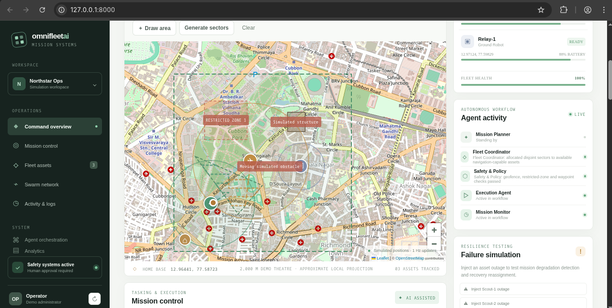
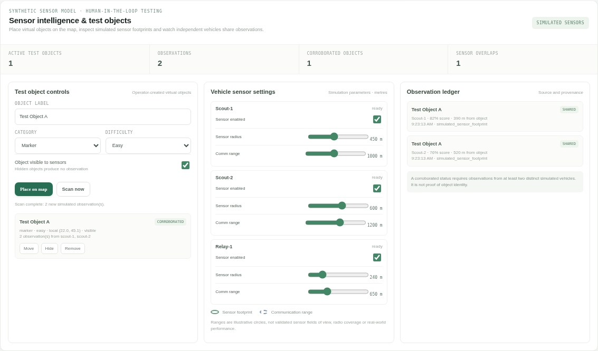
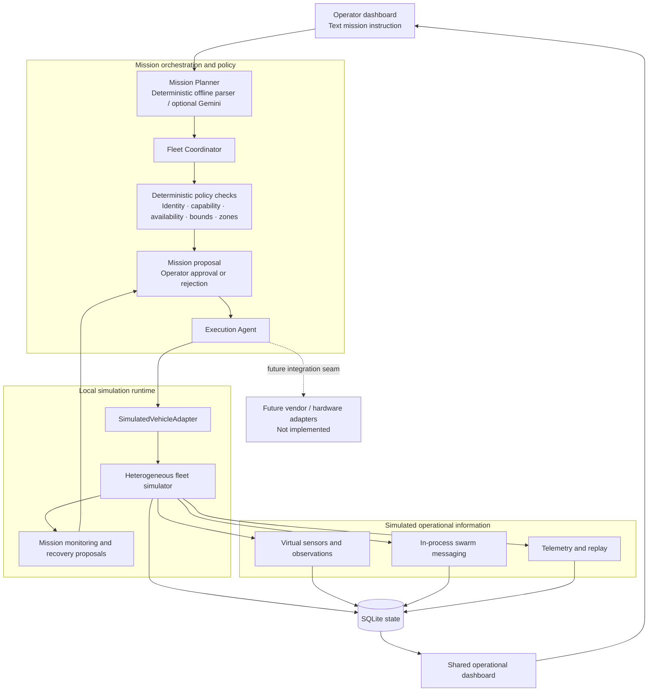

# OmniFleet AI

**Simulation-first mission orchestration for heterogeneous autonomous fleets.**

OmniFleet turns supported operator instructions into reviewable fleet proposals. It separates planning, coordination, policy checks, human approval and execution, then brings simulated state and mission history into one dashboard.

> **Scope:** v0.0.1 is a software-only simulation. It does not control physical drones or robots, connect to manufacturer systems, or provide a validated flight-control or collision-avoidance system.

## Dashboard preview

<!-- Upload the new fleet-and-map screenshot to docs/images/omnifleet-fleet-map.png -->



| Sensor intelligence | Blackbox analytics |
|---|---|
|  |  |

## The engineering problem

Autonomous fleets are fragmented across vehicle types, capabilities, command interfaces and telemetry formats. A unified operator experience must select capable assets, coordinate assignments, enforce constraints and present a coherent fleet view.

OmniFleet explores this **orchestration layer** with three heterogeneous simulated assets, supported text-to-proposal workflows, capability checks and mandatory operator approval. Its dashboard combines simulated fleet state, synthetic observations, swarm messages and blackbox history. It does not implement hardware interoperability: no vendor adapters or physical telemetry integrations are included. See [Interoperability Scope](docs/INTEROPERABILITY_SCOPE.md) for the full boundary and roadmap.

## How it works

Proposal generation is separate from safety validation and execution. Planner output is treated as untrusted input: deterministic backend checks run before approval and are repeated before dispatch.



The active dispatch path ends at `SimulatedVehicleAdapter`. `PX4SITLAdapter` is a non-operational placeholder that refuses dispatch. The current adapter boundary is an extension point, not a production-ready plugin framework.

## What you can explore

- **Mission proposals:** inspect structured actions, planner/coordinator traces and validation results. The deterministic offline planner supports a limited instruction set; optional Gemini-backed planning is configurable.
- **Heterogeneous assignment:** coordinate Scout-1 (quadrotor), Scout-2 (fixed-wing aircraft) and Relay-1 (ground robot), with capability and availability checks.
- **Human-supervised execution:** approve or reject proposals; backend safety checks run again before dispatch.
- **Failure recovery:** inject a simulated failure, inspect replacement candidates and see incompatible assignments rejected.
- **Area coverage:** draw a bounded area and generate non-overlapping fleet sectors and sweep waypoints.
- **Sensor-to-task workflow:** generate synthetic observations, inspect multi-source corroboration and peer task negotiation. Missions still require approval.
- **Operational history:** review fleet state, events, telemetry, observations, messages and blackbox replay.

All listed behaviours run in software or simulation; they do not establish performance on real vehicles.

## Implemented, simulated and future scope

| Area | v0.0.1 status | Meaning |
|---|---|---|
| Mission planning, fleet coordination, policy checks and approval workflow | **Implemented** | Working application logic for supported text instructions and structured proposals. |
| Vehicle identities, capability profiles and mixed fleet | **Simulated** | Three different asset profiles share an internal model; no physical vendor platforms are connected. |
| Movement, routing, coverage, separation checks and recovery | **Simulated** | Behaviour runs in a local 2-D environment using simplified deterministic models and heuristics. |
| Sensors, observations, telemetry and swarm communication | **Simulated** | Virtual objects, synthetic observations and an in-process message bus; no physical sensors or radios. |
| Dashboard, API and SQLite persistence | **Implemented locally** | Local single-process application; not a production multi-user service. |
| Vendor-specific adapters, real telemetry, cameras/computer vision, radio links, voice input and external C2 integration | **Future work** | Not implemented or connected in this release. |

For the full breakdown, read [Interoperability Scope](docs/INTEROPERABILITY_SCOPE.md). For components, responsibilities and trust boundaries, see [System Architecture](docs/01_SYSTEM_ARCHITECTURE.md) and [Agent Design](docs/02_AGENT_DESIGN.md).

## Run locally

**Requirements:** Python 3.10+, `pip` and a modern browser. Internet is only needed for map tiles and optional Gemini API calls; offline planning needs no key.

### Linux / macOS

Extract the project, open a terminal in the `omnifleet-ai` directory, then run:

```bash
python -m venv .venv
source .venv/bin/activate
pip install -r requirements.txt
cp .env.example .env
uvicorn backend.main:app --reload
```

### Windows PowerShell

```powershell
python -m venv .venv
.venv\Scripts\Activate.ps1
pip install -r requirements.txt
Copy-Item .env.example .env
uvicorn backend.main:app --reload
```

Open **http://127.0.0.1:8000**. The first run seeds the three demo assets; SQLite state is stored at `data/omnifleet.sqlite3`.

## Try a short workflow

1. Open **Mission Control** and enter: `Send Scout-1 north and Scout-2 east. Keep Relay-1 stationary.`
2. Generate the proposal and inspect the requested actions, vehicle assignments and validation checks.
3. Approve the proposal and watch the simulated fleet state update on the map.
4. Inject a simulated failure and inspect the recovery proposal and candidate-vehicle compatibility checks.
5. Open **Sensor Intelligence** to place a virtual object and scan it. Explore **Swarm Intelligence & Communications** to inspect simulated message delivery and peer coordination.
6. Open **Blackbox Analytics** to review per-vehicle telemetry and event history.

See the [Operator Guide](docs/OPERATOR_GUIDE.md) for detailed steps and reproducible scenarios.

## Technology

- **Backend:** Python, FastAPI
- **Frontend:** HTML, CSS and JavaScript
- **Persistence:** SQLite
- **Optional planning provider:** Gemini Developer API
- **Mapping:** Leaflet and OpenStreetMap tiles, with a schematic fallback
- **Testing:** pytest and Playwright/Chromium browser checks

## Verification snapshot

The project's recorded v0.0.1 verification, dated **8 November 2026**, reports:

- **77/77** automated pytest tests passed.
- **13/13** browser interaction groups passed; **192/192** browser-triggered API requests returned HTTP 200.
- A dedicated Chromium automation workflow completed a sensor-to-task-to-approval-to-completion scenario with 131 API requests and no HTTP or browser errors.
- A separate Uvicorn workflow completed a delayed peer-negotiation mission after 95 simulation ticks; the expected approval refusal while the coordinator link was unavailable was also verified.
- Python compilation and JavaScript syntax checks passed.

The regression suite includes mission approval and recovery, capability checks, area coverage, sensor corroboration, delayed peer negotiation, packet loss, battery recovery, moving-obstacle handling and synchronized 2-D trajectory scenarios. These results demonstrate tested simulator behaviour—not physical vehicle performance, certified collision avoidance or hardware integration. See [Testing & Verification](docs/TESTING_AND_VERIFICATION.md) for details and test limitations.

To rerun the core checks from the project root:

```bash
pip install -r requirements-dev.txt
python -m pytest -q
python -m compileall -q backend tools tests
node --check frontend/app.js
```

Browser acceptance tests additionally require Playwright Chromium. See the testing guide for the browser commands.

## Configuration

The default mode is offline. To enable Gemini-backed planning, edit `.env`:

```dotenv
AI_PROVIDER=gemini
GEMINI_API_KEY=your_key_here
GEMINI_MODEL=gemini-2.5-flash
```

Keep `.env` out of version control. The repository includes `.env.example`. If Gemini is not configured or unavailable, the application falls back to deterministic offline planning. Swarm, sensor and blackbox simulation features do not require an LLM.

## Documentation

- [Getting Started](docs/GETTING_STARTED.md) — installation and configuration.
- [Operator Guide](docs/OPERATOR_GUIDE.md) — dashboard controls and demonstrations.
- [System Architecture](docs/01_SYSTEM_ARCHITECTURE.md) and [Agent Design](docs/02_AGENT_DESIGN.md) — components, trust boundaries and agent responsibilities.
- [System Capabilities & Behaviour](docs/SYSTEM_CAPABILITIES_AND_BEHAVIOUR.md) — detailed feature reference.
- [Interoperability Scope](docs/INTEROPERABILITY_SCOPE.md) — implemented, simulated and future integrations.
- [API Reference](docs/API_REFERENCE.md) — HTTP endpoints and contracts.
- [Swarm Communications](docs/11_SWARM_COMMUNICATIONS.md), [Sensor & Blackbox Design](docs/13_SENSOR_INTELLIGENCE_BLACKBOX.md) and [Area Coverage](docs/10_AREA_COVERAGE_ORCHESTRATION.md) — subsystem details.
- [Testing & Verification](docs/TESTING_AND_VERIFICATION.md) and [Safety & Limitations](docs/SAFETY_AND_LIMITATIONS.md) — test evidence, scope and non-goals.

## Safety and limitations

OmniFleet is intended for software demonstration and engineering exploration only.

- No physical vehicle, autopilot, camera, computer-vision pipeline, radio or external command-and-control system is connected.
- Motion, sensing, battery estimates, communications and collision/separation behaviour use synthetic or simplified models.
- Route, geofence and separation checks are not certified safety systems. The project has not undergone security, penetration, production-load, multi-user or hardware-in-the-loop validation.

**Do not use OmniFleet to navigate, control or make safety-critical decisions about real vehicles.** Read [Safety & Limitations](docs/SAFETY_AND_LIMITATIONS.md) before experimenting with the simulator.
