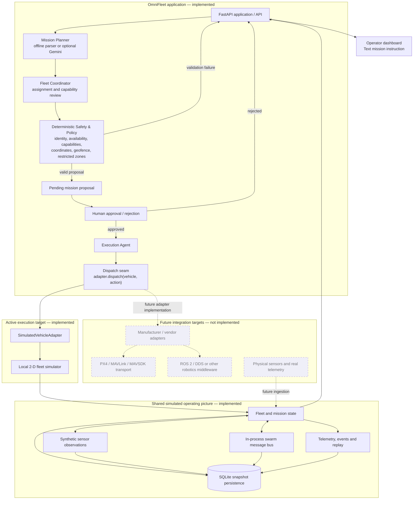

# System Architecture — v0.9.2

OmniFleet is a **simulation-first mission-orchestration prototype**. Its architecture explores how one operator-facing command layer can plan and coordinate a heterogeneous fleet through a shared internal model, while keeping deterministic policy checks and human approval between proposed intent and dispatch.

This is an architectural exploration of the interoperability problem—not a claim that this release integrates different manufacturers' physical products. The only active execution target is the local simulator.

## Architecture and trust boundaries

The solid path below is implemented in v0.9.2. Dashed nodes and connectors indicate possible integration targets, not working connections. The PX4 class currently present in the repository is deliberately non-operational and is not selected by the running application.

**Boundary interpretation:**

- The planner and coordinator create/review proposals. They do not dispatch directly.
- The safety/policy component is deterministic and runs before the proposal can be approved. It can reject the whole proposal.
- The operator approval gate is a separate step. The backend validates again before dispatch.
- `main.py` currently binds the active `adapter` to `SimulatedVehicleAdapter`. The dispatch seam is a method-level boundary (`adapter.dispatch(...)`), not yet a production plugin framework or a fully specified vendor-driver contract.
- `PX4SITLAdapter` exists only as a placeholder that raises an error. It is not wired into the active path and sends no MAVLink commands.
- Sensors and swarm communications contribute to the common simulated operating picture, but both operate on generated data and in-process messages.

## Why this architecture explores interoperability

A mixed fleet needs more than a unified map. An orchestration layer must reason about asset identity, supported actions, mission capabilities, availability and current state before assigning work. It must then translate a platform-independent mission proposal into whatever command representation a particular platform accepts, while bringing status and telemetry back into a consistent operating picture.

OmniFleet prototypes the **orchestration and policy side** of that problem:

1. Three simulated asset profiles share a common internal representation while retaining different vehicle kinds and capabilities.
2. The planner turns text instructions into structured actions; the coordinator reviews assignments against the fleet profile.
3. Deterministic validation checks whether the requested action is allowed and whether the selected asset can perform it.
4. An operator approves the complete proposal before the simulator receives dispatch calls.
5. Fleet state, synthetic observations, messages and blackbox samples are exposed through a single application and dashboard.

The current code does **not** implement the manufacturer-specific translation and physical transport needed to claim real hardware interoperability. The vehicle profiles are simulated examples, not integrations with three real vendors.

## Main components

| Component | Current responsibility | Boundary |
|---|---|---|
| Dashboard (`frontend/`) | Mission text, fleet map, proposals, approval, sensors, swarm and blackbox views | Operator interface only; server revalidates actions |
| FastAPI (`backend/main.py`) | HTTP API, application state, proposal lifecycle and persistence coordination | Single-process modular monolith |
| Mission Planner (`backend/agents.py`) | Offline intent parser or optional Gemini planning | Produces untrusted proposal data; not dispatch authority |
| Fleet Coordinator | Reviews requested assignments and capability compatibility | Proposal coordination only |
| Safety & Policy | Deterministic allowlist, identity, availability, capability, coordinate and geospatial checks | May reject; never dispatches |
| Execution path | Dispatches an approved action through the active adapter | Simulator only |
| `SimulatedVehicleAdapter` | Calls local simulator dispatch logic | Active adapter in v0.9.2 |
| `PX4SITLAdapter` | Explicitly refuses dispatch | Placeholder only; not wired into the running app |
| `SwarmNetwork` (`backend/swarm.py`) | In-process structured messages, simulated peer/coordinator links and negotiation | Not a real radio or distributed network |
| `SensorSimulation` (`backend/sensors.py`) | Virtual objects, geometric scans, synthetic observations and telemetry | Not a camera or perception stack |
| SQLite (`backend/db.py`) | Local application snapshot persistence | Single-process demo storage, not distributed state/event sourcing |

## Main data flows

### Mission proposal and execution

`Operator instruction → Planner → Coordinator → deterministic policy validation → PENDING_APPROVAL → operator decision → backend revalidation → SimulatedVehicleAdapter → local simulator → updated fleet state`.

A failed validation rejects the proposal. An operator rejection leaves it undispatched. Approval is necessary but does not override backend validation.

### Shared operating picture

`Simulator state + synthetic observations + in-process swarm messages + blackbox samples → FastAPI state/API → dashboard and SQLite snapshot`.

This is a unified **simulated** view. It is not a common operating picture federated from external command systems or manufacturer feeds.

### Sensor-to-inspection workflow

`Virtual test object → geometric sensor scan → synthetic observation ledger → simulated SENSOR_OBSERVATION message → corroboration policy → inspection proposal → operator approval → simulator dispatch`.

Corroboration means multiple simulated sources reported the same virtual object revision. It does not verify the real-world identity of an object.

## State, persistence and runtime model

- The application is a modular monolith served by one FastAPI process.
- Startup loads or seeds the demo fleet and restores the SQLite snapshot.
- Simulation ticks advance local vehicle state, update the synthetic network/sensor model, capture bounded blackbox samples and persist the snapshot.
- There is no multi-process coordination, distributed consensus or production-grade event-sourced state store.
- The default offline path works without an AI API key. When configured, Gemini may assist the Planner and Coordinator; deterministic safety validation remains server-side.

## Extension path for real interoperability

A future hardware integration would need considerably more than replacing the current class name. At minimum it would require:

1. A documented adapter contract for capability discovery, command submission, acknowledgements, telemetry and fault reporting.
2. Vendor/platform-specific adapters that translate validated internal actions to each supported platform's API/protocol.
3. Freshness, sequencing, idempotency, timeout, cancellation and reconnect semantics for command/telemetry channels.
4. A normalized asset capability and state model that preserves vendor-specific details without hiding safety-critical differences.
5. Authentication, authorization, encrypted transport, audit integrity and deployment hardening.
6. Independent integration testing, hardware-in-the-loop testing, hazard analysis and qualified review before any physical operation.

These are future engineering requirements, not features delivered by v0.9.2. See [Interoperability Scope and Roadmap](INTEROPERABILITY_SCOPE.md) and [Safety & Limitations](SAFETY_AND_LIMITATIONS.md).
